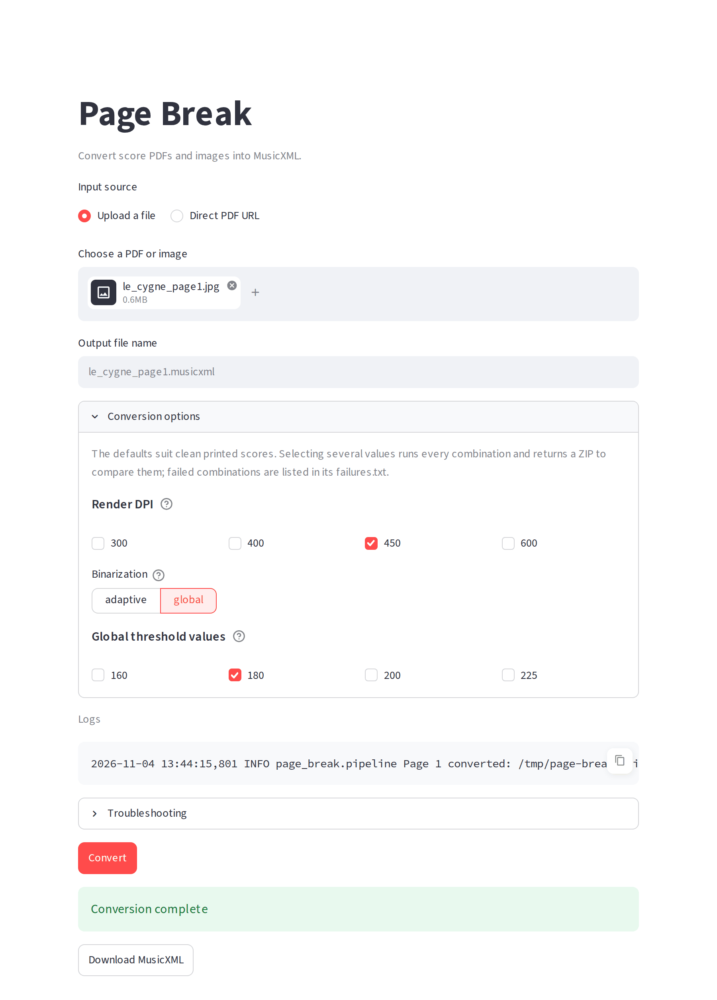

# Page Break

[](https://github.com/victorzinho/page-break/actions/workflows/ci.yml)

Turns score PDFs and images into MusicXML you can open in MuseScore, Sibelius, Dorico or Finale.

It wraps the [Audiveris](https://github.com/Audiveris/audiveris) optical music recognition engine with what messy
real-world input needs: page rendering, blank-page skipping, parallel recognition, merging and clear failure
reports.

Clean printed or exported scores work well. Phone photos, handwritten annotations, low contrast and tuplet-heavy
passages degrade results quickly.



## Quick setup

1. Install [Audiveris](https://github.com/Audiveris/audiveris/releases) (tested with 5.10) and add the folder holding
   its `Audiveris` executable to your `PATH`.
2. Install [uv](https://docs.astral.sh/uv/getting-started/installation/).
3. Start the GUI; it opens in your browser:

   ```bash
   uvx --from git+https://github.com/victorzinho/page-break page-break gui
   ```

## CLI

Install the `page-break` command, then run the same conversion from the command line (`page-break convert --help`
for every option):

```bash
uv tool install git+https://github.com/victorzinho/page-break
page-break convert score.pdf score.musicxml --dpi 450 --binarization global --threshold 180
```

Images should be at least 300 DPI; below that, Audiveris can't find the staff lines.

## Development

Needs [uv](https://docs.astral.sh/uv/) and [just](https://just.systems/).

```bash
just gui
just convert score.pdf score.musicxml
just check
```

## License

[MIT](LICENSE)
